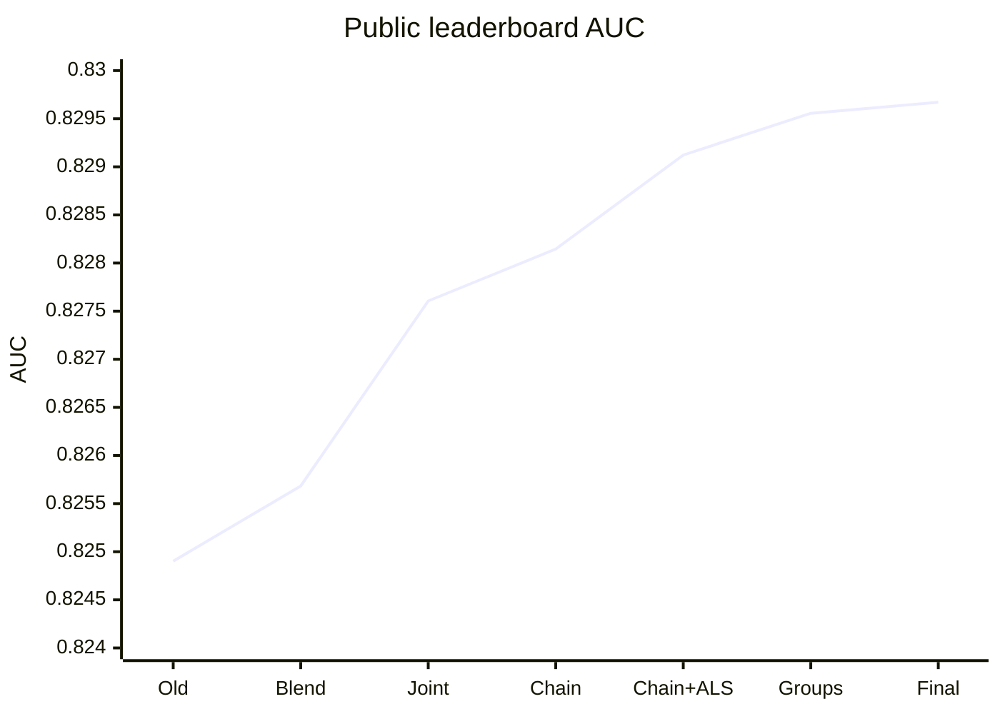
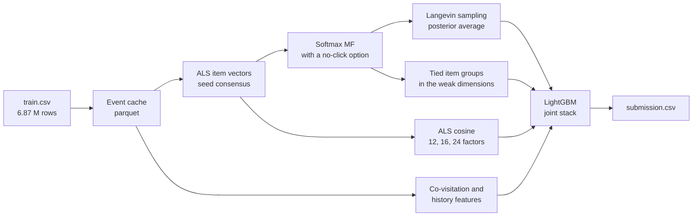

# Click Prediction: Huawei TechArena 2026, Phase 1


> **Final result: ROC AUC 0.829671 on the public leaderboard.** Random ranking scores 0.5.
> The best single pipeline scored 0.829556. Our first full pipeline scored 0.824902.

| | |
|---|---|
| **Task** | Predict the click probability of each of 529,390 shown items (52,939 events, 10 items each) |
| **Metric** | ROC AUC over all rows; only the ranking counts |
| **Training data** | 6.87 M labelled impressions in 686,824 events, 20-27 January 2025 (synthetic) |
| **Best submission** | 0.829671 public: rank blend, 70% tied-groups stack and 30% chain + ALS stack |
| **Best single model** | 0.829556 public: LightGBM over softmax matrix factorisation, Langevin samples, ALS and item-group features |
| **Research** | 12 written hypotheses, 43 numbered experiment rounds, every result logged |
| **Built** | 26 October - 3 November 2026 |

The final ranking used a separate private leaderboard, which is not reported here.

## What this project is

TechArena Phase 1 is a click-prediction task on synthetic recommendation logs. A user is shown 10 candidate items at once and clicks at most one, or none. For each user's first event after the training cutoff, we predict how likely each candidate is to be clicked.

We studied how the data was likely generated, built a choice model that matches it, and stacked that model with gradient-boosted features.

## Results

Public leaderboard AUC for each submission that set a new best, in order:



| # | Submission | What changed | Local v24 | Public AUC |
|---|---|---|---|---|
| 1 | Old pipeline | Co-visitation, ALS and history features into a LightGBM ranker | 0.80790 | 0.824902 |
| 2 | 60/40 rank blend | Blend of the old stack and the softmax stack | 0.81171 | 0.825683 |
| 3 | Joint LightGBM | Softmax MF and old features in one model | 0.81305 | 0.827606 |
| 4 | Chain | Adds averaged Langevin samples of the softmax model | 0.81414 | 0.828145 |
| 5 | Chain + ALS | Adds ALS cosine columns at 12, 16 and 24 factors | 0.81524 | 0.829122 |
| 6 | Tied groups | Adds softmax features with item groups shared in the weak dimensions | 0.81581 | 0.829556 |
| 7 | **Final blend** | **Rank blend of 6 and 5 (70/30), each scaled by 0.97** | – | **0.829671** |

"Local v24" is our validation: each user's first event from 24 to 26 January, with everything fitted on earlier data. It ordered submissions 2 to 6 the same way as the public leaderboard, with a steady gap of 0.0137 to 0.0146. It ranked the old pipeline too low.

## How it works



1. **Choice model.** Each event is a softmax over its 10 candidates plus a "no click" option (`techarena/softmf.py`). It is fitted by maximum a posteriori estimation on every impression. Clicks from before the training period appear only in histories, so each enters as a partial likelihood. Without them AUC falls from 0.81 to 0.68.
2. **Start from ALS.** The softmax starts from ALS item vectors that several seeds agree on. From random vectors it reaches only 0.62.
3. **Average over the posterior.** Preconditioned Langevin sampling at temperature 0.3 averages predictions over many plausible vector sets. It was the first Bayesian method to beat the point estimate here (0.8088 to 0.8104 alone).
4. **Item groups.** Items have about 8 strong taste dimensions and a weak tier that mostly marks membership in hidden groups. Sharing one weak vector per group (K = 30) cuts estimation noise.
5. **Stack.** A LightGBM model combines these scores with co-visitation, ALS and history features.

## What we found

- **The data looks generated from an 8-dimensional sphere.** Every coordinate of the fitted user and item vectors has kurtosis of about -0.6. That is the value for points uniform on a sphere in 8 dimensions. We inferred this from the fitted vectors; the organisers did not state it.
- **There is a weak second tier.** Seed agreement continues to about 16 dimensions, and those extra item dimensions cluster on real data but not on a rank-8 replica.
- **A synthetic replica measured the gap to the ceiling.** We simulated the real event structure with known vectors. Perfect vectors would score about 0.914 on it, against 0.829 for our model, and better item vectors are where most of that room lies.
- **Calibration was not the bottleneck.** Leaderboard probes that rescaled event-level scores moved AUC by under 0.0001 at best.

## What did not work

Each was tested and logged in `reports/experiment_log.md`.

| Idea | Result |
|---|---|
| Variational Bayes, bootstrap ensembles | 0.796 and 0.8046, against 0.8058 for the point estimate |
| Taste dimensions other than 8 in a plain softmax | 0.77 to 0.80 |
| Exposure-corrected spectral item vectors | 0.574, against 0.7755 for ALS |
| Attention over the click history | 0.703, against 0.711 |
| Taste drift, context effects, fatigue, repeat decay | No signal in this data |
| Multi-start chains, LightGBM seed averaging | Within noise |

## Reproduce

Requires Python 3.13 and [uv](https://docs.astral.sh/uv/). Peak memory is about 23 GB, so use a machine with 32 GB or more.

```bash
make requirements                                   # install dependencies
make data                                           # download raw files and convert to parquet
export PYTHONPATH=.
.venv/bin/python research/build_als_columns.py eval
.venv/bin/python research/build_submission.py eval 430 models/submission_groups.csv
.venv/bin/python research/validate_submission.py models/submission_groups.csv
```

| Step | Approximate time | Peak memory |
|---|---|---|
| `build_als_columns` | 10-20 min | Under 10 GB, estimated |
| `build_submission` | 1-1.5 hours from an empty cache | 21 GB plus about 2 GB for sampling, estimated |

Times come from separate runs on a 48 GB Mac using the MPS device. The full sequence has not been rerun from an empty cache, and MPS training is not fully deterministic, so scores vary slightly between runs.

To validate on a past window, replace `eval` with its start time, for example `1737676800` (v24) or `1737849600` (v26), and leave out the round count and output file.

The final blend has no script. It rank-averages `submission_groups.csv` (70%) and `submission_chain_als.csv` (30%) after scaling each event-level logit by 0.97.

<details>
<summary>Earlier joint LightGBM pipeline (public 0.827606)</summary>

```bash
.venv/bin/python -m techarena.events                 # optional: load_cache builds it when missing
.venv/bin/python -m techarena.modeling.joint validate
.venv/bin/python -m techarena.modeling.joint submit   # writes models/submission_joint.csv
.venv/bin/python -m techarena.modeling.joint check models/submission_joint.csv
```

`validate` takes about 5 minutes and 15 GB; `submit` about 7 minutes and 21 GB. `submit` overwrites `models/submission_joint.csv` unless you pass `--output`.

</details>

## Repository layout

```
techarena/            core package
├── events.py         event cache built from the raw CSVs
├── softmf.py         softmax matrix factorisation with an outside option
├── choice.py         choice-model features
├── embeddings.py     ALS taste vectors
├── features.py       co-visitation and history features
├── validation.py     time-based validation splits
└── modeling/         baseline, joint LightGBM, Optuna tuning
research/             final pipeline scripts and experiment logs (rNN.log)
├── tier.py           two-tier softmax (strong and weak dimensions)
├── groupfit.py       tied item groups
├── chain.py          Langevin sampling
└── build_*.py        ALS columns and the final submission
reports/              experiment_log.md, experiments.jsonl
tests/                unit tests (make test)
hypotheses.md         every hypothesis with its test and status
research_notes.md     papers behind each idea and what happened here
```

## Team

- [@h0pers](https://github.com/h0pers)
- [@ilieg02](https://github.com/ilieg02)
- [@letv1nnn](https://github.com/letv1nnn)

## Further reading

- [`reports/experiment_log.md`](reports/experiment_log.md): every change, its score, and whether it was kept
- [`hypotheses.md`](hypotheses.md): hypotheses H1-H12 with outcomes
- [`research_notes.md`](research_notes.md): sources for each idea, from Rendle et al. 2020 to Ahn et al. 2015
